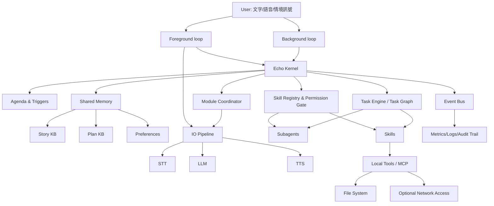
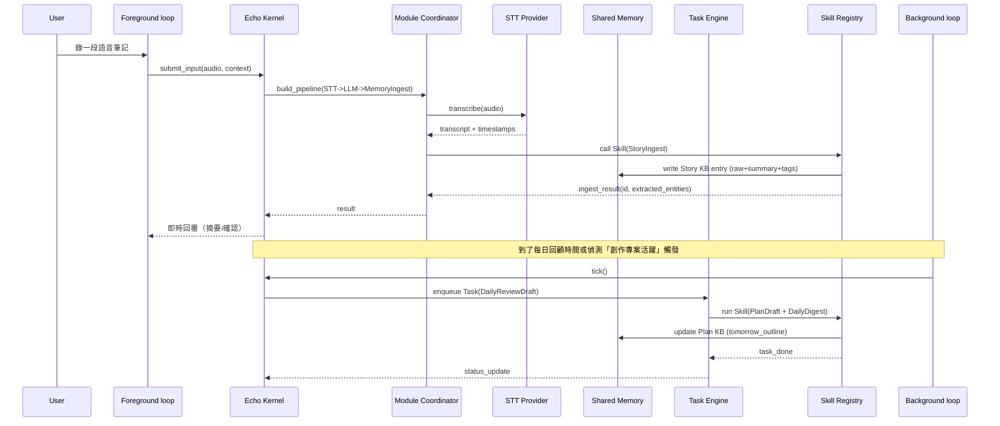
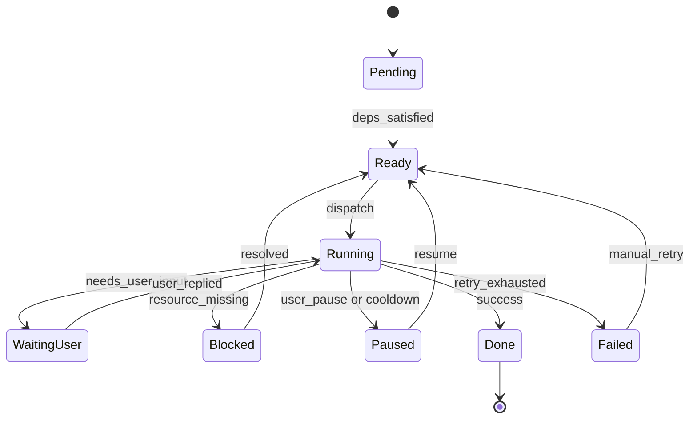
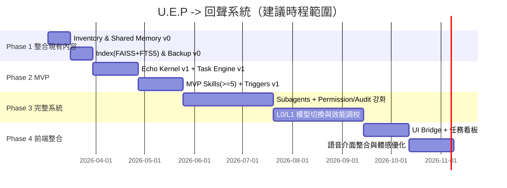

> **【已被取代】** 本文（Echo Kernel 藍圖）已於 2026-10-26 被取代（DECISIONS A5）。現行依據為 [UEP 新架構技術設計提案](../hidden_docs/架構重構/UEP_新架構研究/UEP_新架構技術設計提案_2026-10-25.md) 與 [Core 契約草案](架構重構/Core契約草案.md)。雙迴圈、Skill Registry、Safe／Risky、離線分級 L0–L2 等舊用語的新對應見契約草案「改進計畫用語對照」一節。以下原文保留供歷史參考，不再更新。

# 將現有 U.E.P 改造為「回聲系統」個人助理：分析與可執行開發規劃報告

## Executive Summary

本報告提出一條可落地、可逐步交付、且「離線優先（offline-first）」的改造路線，將你現有的 U.E.P（桌面助理／事件流式功能＋聊天系統）升級為「回聲系統」：一個能長期陪伴創作、具備共享記憶庫（故事知識＋計畫＋偏好）、可半主動觸發、並以 Skills/Subagents 自主推進任務的個人助理。

改造關鍵不在於「加更多功能」，而是在於把系統中心從「一次性事件處理 pipeline」轉移為「長壽命、可維持狀態、可安排背景工作的核心」。因此，本報告強烈建議以 **Echo Kernel（回聲核心）** 作為新的系統主語：集中管理 Shared Memory（Story KB / Plan KB / Preferences）、Agenda & Triggers（半主動調度）、Task Engine（Task Graph＋狀態機＋排程）、Skill Registry（能力編排＋權限閘門），並拆分執行路徑為 **Foreground loop（互動前台）** 與 **Background loop（半主動後台）**，讓「你沒開口時」系統也能做低干擾的整理、預備與推進。

在本地化與部署策略上，本報告採用 **L0/L1/L2 模型分級** 以兼顧「離線可用、延遲可控、必要時才上雲」：

- **L0（永遠可用，完全離線，低延遲）**：以小型／中型本地 LLM + 本地 embed + 本地 STT/TTS 的「可用性優先」組合，確保任何時候都能完成：記憶寫入、章節摘要、簡易計畫拆解、低成本對話。
- **L1（離線高品質，較重但仍本地）**：用於更長文本、更強推理、較高品質語音；例如升級到 14B/24B 級的本地模型、或採用更高品質 TTS（你現有 BigVGAN 管線即屬高品質 vocoder 方向）。BigVGAN 作為通用 vocoder 的設計與泛化能力在原始論文中被強調。citeturn0search2turn11search1
- **L2（可選，上雲／外部 API）**：只在你允許且「確實需要」時使用，例如大規模重寫、多文件綜合推理、或臨時網路蒐集，並以明確權限與審計紀錄控制。

模型候選上，若以「繁體中文創作＋工具型助理」為主要場景，本報告建議將 **Qwen2.5 系列**作為 L0/L1 的首選語言模型骨幹：其開源權重版本涵蓋 0.5B～72B 多尺寸，且在模型卡中明示支援包含中文在內的多語言（>29 語言）、並採 Apache-2.0 授權（多數尺寸）。citeturn7view0turn12view0turn9search2  
推理引擎方面，建議把「本地低延遲」與「高吞吐服務化」分為兩條路徑並存：  
- 低門檻單機：`llama.cpp`（GGUF 格式、彈性量化、可 CPU/GPU）citeturn11search13turn2search0  
- 高吞吐服務：`vLLM`（PagedAttention、連續 batching、KV cache 管理）citeturn2search13turn2search5turn2search9

語音方面，你現有系統使用 Whisper-Large 與自建 TTS（S2Mel＋BigVGAN 等）導致體積大（~60GB）與載入延遲高，問題多半不只在模型大小，也在「常駐策略」與「按需載入」尚未徹底。Whisper 原始論文與後續高效推論實作提供了兩條可行路線：  
- STT：Whisper（基線）citeturn0search0turn0search8 → `faster-whisper`（CTranslate2 推論、宣稱同精度下可更快且更省記憶體、並支援 8-bit 量化）citeturn0search1turn11search0  
- 長音檔時間戳：WhisperX 以 VAD + forced alignment 取得 word-level timestamps 的設計可直接借用在「創作語音筆記」或「會議紀要」等場景。citeturn4search3turn4search7

記憶與資料管理方面，本報告採用「結構化 KB + 向量索引 + 全文索引」的混合策略，並把隱私與離線優先落實到：
- 所有個人資料預設只落地在本機（可加密），
- 外網存取是「Risky」權限，需要清楚的使用者允許，
- 技能分級（Safe vs Risky）＋可審計事件紀錄（Who did what, when, why）。

開發規劃採 **四階段**交付（整合現有內容 → MVP → 完整系統 → 前端整合），每階段都定義明確目標、可交付物、里程碑、風險與驗收標準。此路線允許你先把前端「暫時脫機」以降低干擾，同時快速把回聲核心跑起來；在 MVP 穩定後，再逐步把語音與視覺介面整合回去。

---

## 需求與成功指標

回聲系統相較於一般桌面助理，需求差異主要在「系統的時間尺度」與「主動性」：

- **長期持續狀態**：需要可維持數週～數年的 Story KB / Plan KB，並能持續更新、回溯、版本化。
- **半主動觸發**：不是只有你下指令才工作，而是在「你正在寫／你卡住了／到了某個時間」時，提供低干擾的下一步與預備素材。
- **可執行的協作**：不只回答問題，而是能把事情拆成 Task Graph，排程進背景，並回寫成果到記憶庫。

建議用下列「可量測」成功指標作為驗收基準（後續各階段會再細化到每個里程碑）：

- **離線可用性**：在完全無網路時，仍可完成「對話回應、寫入 Story KB、產出今日大綱草案、建立/更新任務」。  
- **互動延遲**：L0 模式下，文字對話 **TTFT（time-to-first-token）** 目標 < 1.0 秒、一般回應 5–80 tokens 的可用體感；語音路徑可先以文字 MVP 為主，之後再訂 RTF（real-time factor）目標。  
- **半主動干擾控制**：觸發提示具備冷卻時間、情境 gating、可靜音／可延後，並可在日誌中回溯「為何觸發」。  
- **記憶品質**：新增內容能在 1 次 ingestion 後，於檢索/問答中被正確引用（可用測試集合驗證）。向量檢索引擎（如 FAISS）就是為相似度檢索與聚類而設計。citeturn0search3turn0search11  
- **安全與權限**：所有會修改檔案、外網存取、刪除/搬移資料等行為，必須經風險分級與審計紀錄落地（至少 MVP 時就應具備）。

---

## 系統架構設計

本節定義回聲系統的核心元件、責任邊界、以及 Event Bus / Module Coordinator 的角色變更，並提供元件互動圖與通訊序列。

### 架構總覽與角色變更

核心設計主張：

- **Echo Kernel 是新的「系統主語」**  
  管理共享記憶、計畫/任務、觸發器與技能調度；它不是單次事件處理器，而是常駐「協作個體」。
- **雙迴圈：Foreground / Background**  
  - Foreground loop：處理你的直接互動（文字/語音）、快速回覆、即時工具呼叫。  
  - Background loop：低頻輪詢或事件驅動，進行任務推進、索引更新、每日回顧草案等。
- **Event Bus 繼續保留，但降級為通訊骨幹**  
  用於模組解耦、事件記錄與觀測。
- **Module Coordinator 由指揮官降級為「管線協調器」**  
  不再做系統級決策，而是依 Echo Kernel 指派，去協調既有模組（STT/TTS/工具模組）完成一段 pipeline。

### 元件互動圖（Mermaid Flowchart）



此圖對應本報告的責任切分：Echo Kernel 對外只暴露「意圖處理、任務管理、技能調度」介面；既有模型與工具模組被視為可插拔的 providers，並由 Coordinator 組裝成不同品質等級的 pipeline。

### 模組通訊序列（Mermaid Sequence）

以下以「語音筆記 → 自動摘要入 Story KB → 建立明日大綱草案」為例，展示回聲系統如何在前台與後台協作。WhisperX 的設計展示了在長音檔處理中以 VAD 切分、再 forced alignment 取得精準時間戳的務實路徑，這裡可作為語音筆記 ingestion 的參考。citeturn4search7turn4search3



---

## 資料管理與安全策略

回聲系統的「共享資料」不是單一向量庫，而是由三類資料組成，並以可變更、可回溯、可備份為核心原則。

### 記憶庫格式與索引層設計

建議採用「三層存放」：

- **Raw Store（原始資料層）**：Markdown / 純文字 / 音訊轉寫結果 / 章節檔快照。  
  目的：可回溯、可重建索引、可在模型更新後重新摘要。
- **Structured Store（結構層）**：JSON/YAML/SQLite（建議）  
  - Story KB：角色、地點、事件、時間線、章節摘要、設定條目。  
  - Plan KB：目標、里程碑、任務樹、今日焦點、阻塞原因。  
  - Preferences：口吻、禁忌、提示頻率、輸出格式偏好。
- **Index Store（索引層）**  
  - 向量索引：FAISS（本地、成熟、支援大規模向量相似度檢索與 GPU 加速）。citeturn0search3turn0search7  
  - 全文索引：SQLite FTS5（本地、易部署、適合精準關鍵字與片語檢索）。citeturn5search3

> 實務建議：向量檢索解決「語意相近」；FTS5 解決「特定詞、專名、精確片語」；兩者混用可降低 hallucination 風險與漏找問題。

### 同步、備份與離線優先

- **離線優先預設**：所有 Story/Plan/Preferences 落地本機；外網存取必須是「顯式允許」且有可追蹤紀錄。  
- **備份策略（建議最低配置）**：  
  - 每日：增量備份（SQLite + Raw Store）  
  - 每週：完整快照（含 FAISS index，可選）  
  - 每月：離線歸檔（壓縮 + 可加密）  
- **索引可重建**：FAISS 與摘要可由 Raw Store 重跑重建，因此備份可以「Raw+Structured 為主、Index 為輔」。

### 權限分級：Safe vs Risky Skills

- **Safe Skills（預設可自動執行）**  
  - 只讀：讀取 KB、讀取指定資料夾內容（不改檔）  
  - 只寫內部 KB：新增摘要、更新計畫、更新偏好（不碰外部檔）  
- **Risky Skills（需要更高權限或逐次批准）**  
  - 任何外網存取（下載資料、查詢、上傳）  
  - 任何檔案系統破壞性操作（刪除、搬移、覆寫章節檔）  
  - 大量批次操作（一次改動 >N 個檔案、或改動超過指定行數）

---

## Task/Workflow 與 Skills/Subagents 規格

回聲系統要能「自主推進」，關鍵在於把工作表示成可管理的 Task Graph，而不是一次性對話。

### Task Engine 與 Task Graph 規格

**Task Graph**：一個有向圖（DAG/或允許迴圈的狀態圖），節點為 Task，邊為依賴與觸發條件。

建議 Task Schema（概念）：
- `task_id`、`title`、`type`（writing/review/research/maintenance）
- `state`、`priority`、`constraints`（offlineOnly、timeWindow、budget）
- `inputs`（引用 Story KB / Plan KB 條目、檔案指標）
- `outputs`（摘要條目、章節草稿、檢查報告）
- `required_permissions`（safe/risky）
- `next_actions`（可生成子 Task）

### Task 狀態機（Mermaid State）



### Subagent 行為範例

- **Nightly Curator（夜間整理者）**  
  觸發：每日固定時間、或偵測到當日有新增創作內容。  
  行為：  
  1) 把當日新增文本做摘要  
  2) 更新世界觀索引（人物/地點/設定）  
  3) 產出 3 個「明天最小可寫切入點」  
  4) 回寫 Plan KB（tomorrow_outline、next_actions）

- **Stuck Breaker（卡關拆解者）**  
  觸發：某 Task 停留在 WaitingUser/Blocked 超過門檻。  
  行為：把 Task 重寫成 2～5 個更小 Task（每個 10–30 分鐘可完成），並提出一個最小下一步。

> 這類子代理的核心是「把輸出回寫到 KB + 生成可追蹤的任務」，使系統具備可持續推進性。

### API/介面定義（JSON 範例）

以下以「本機 HTTP（或 IPC）」風格表示，僅示意欄位與語意：

**建立任務**
```json
{
  "op": "task.create",
  "task": {
    "title": "第12章：主角與反派第一次正面交鋒",
    "type": "writing",
    "priority": "high",
    "constraints": {
      "offline_only": true,
      "time_window": "today"
    },
    "inputs": {
      "story_refs": ["story:chapter11", "story:character:protagonist", "story:character:antagonist"]
    }
  }
}
```

**調用技能（帶權限宣告）**
```json
{
  "op": "skill.invoke",
  "skill": "StoryIngest",
  "permission": "safe",
  "input": {
    "source_type": "text",
    "text": "……（貼上剛寫的段落）……",
    "context": {
      "project": "MyNovel",
      "chapter": "chapter12",
      "timestamp": "2026-02-23T21:10:00+08:00"
    }
  }
}
```

**回寫 Plan KB（由 Task Engine 或 Subagent 產生）**
```json
{
  "op": "plan.update",
  "permission": "safe",
  "patch": {
    "today_focus": "完成交鋒場景的衝突升級",
    "next_actions": [
      "補上反派動機的伏筆（100-200字）",
      "把場景切成三段：挑釁→爆點→收束"
    ],
    "blocked_reason": null
  }
}
```

---

## 部署與本地化策略

本節提出 L0/L1/L2 分級、候選模型比較（含授權、需求、加速選項）、以及 STT/TTS 折衷與載入策略。

### L0/L1/L2 分級定義

- **L0：永遠可用（離線／低延遲／可用性優先）**  
  適用：日常對話、短摘要、任務拆解、記憶寫入、低成本規劃。  
  推論引擎優先：`llama.cpp`（GGUF + 量化）citeturn11search13turn2search0 或輕量推論服務（視你現有架構習慣）。
- **L1：離線高品質（較重，但仍本機）**  
  適用：長文本、較強推理、較高品質語音合成。  
  推論引擎優先：`vLLM`（強 KV cache 管理與吞吐）citeturn2search13turn2search5；或 `TensorRT-LLM`（NVIDIA GPU 最佳化、INT8/FP8/FP4 等量化配方）。citeturn2search17turn2search14
- **L2：可選上雲（最強能力／花費／需授權）**  
  適用：需要更大上下文、或你想用外部資料探勘時；所有 L2 都視為 Risky，必須可追蹤與可關閉。

### 候選 LLM 模型建議與比較

> 下表的「權重大小」是依參數量估算的理論最低值（不含 KV cache、框架 overhead、與長上下文造成的 KV cache 膨脹）。KV cache 管理是服務化推論的主要痛點之一，PagedAttention/vLLM 即針對 KV cache 巨大且動態成長帶來的碎片與浪費提出解法。citeturn2search13turn2search1

| 分級建議 | 候選模型 | 參數量/上下文 | 授權 | 語言特性（與中文） | 權重大小估算（FP16 / INT8 / INT4） | 量化/加速選項（實務） | 推理延遲觀點（風險/參考） |
|---|---|---|---|---|---:|---|---|
| L0 首選 | Qwen2.5-7B-Instruct | 7.61B；長上下文（完整 131,072；生成 8192）citeturn7view0 | Apache-2.0citeturn7view0 | 官方模型卡列出包含中文在內的多語言（>29 語言）citeturn7view0 | ~14.2GB / 7.1GB / 3.5GB | GGUF（llama.cpp）、AWQ/GPTQ（視社群量化）、vLLM 支援多種量化citeturn11search13turn2search5turn2search3 | 7B 級通常可做到即時互動；需以你的硬體實測 TTFT/ tok/s |
| L1 推薦（中文強） | Qwen2.5-14B（或 14B-Instruct） | 14.7B；131,072 tokens（base）citeturn14search3 | Apache-2.0（Instruct LICENSE 即 Apache）citeturn14search7 | 多語言包含中文（同系列策略）citeturn7view0 | ~27.4GB / 13.7GB / 6.8GB | 同上；若要服務化可用 vLLM（PagedAttention）citeturn2search13turn2search5 | 14B 在單卡 12–16GB VRAM 需依量化與上下文控制；可作「高品質模式」 |
| L1 高品質（中文強、較重） | Qwen2.5-32B | 32.5B；131,072 tokensciteturn12view0 | Apache-2.0citeturn12view0 | 多語言包含中文（同系列策略）citeturn12view0turn7view0 | ~60.5GB / 30.3GB / 15.1GB | 大模型建議 vLLM 或 TensorRT-LLM；vLLM 強調 KV cache 與吞吐citeturn2search5turn2search17 | 32B 若要低延遲需 GPU 與量化；可定位為 L1「寫作重任務」 |
| L1 通用低延遲（偏英、可混用） | Mistral Small 3 | 24B；官方強調低延遲並給出 150 tokens/s 的宣稱 citeturn13view0 | Apache-2.0citeturn13view0 | 官方文章未明列中文能力；可作輔助型（工具/規劃） | ~44.7GB / 22.4GB / 11.2GB | 官方提到量化後可在單張 RTX 4090 或 32GB RAM 筆電執行citeturn13view0 | 具公開 tok/s 宣稱，但仍需你在目標機器上實測 |
| L1 推理加強（可選） | DeepSeek-R1 Distill（如 Distill-Qwen-32B） | Distill 系列含 1.5B/7B/8B/14B/32B/70B；並明示授權 MITciteturn15view0 | MIT（含權重）citeturn15view0turn8search0 | 以 Qwen2.5 為底座的 distill 版本對中文通常更友善（因 base 為 Qwen）citeturn15view0 | 以 32B 為例：~59.6GB / 29.8GB / 14.9GB | 官方頁面示例用 vLLM 啟服務citeturn15view0turn2search5 | 推理型模型常出現長 CoT 造成延遲；需用策略限制推理長度 |
| L0/L1 英文通用備援 | Llama 3.1 8B | 8B；128k；語言列出不含中文（列出英/德/法/義/葡/印地/西/泰）citeturn6view1 | Llama 3.1 Community License（含商用條款限制）citeturn6view1 | 中文不是官方列出的支援語言；更適合作為英文工具備援 | ~14.9GB / 7.5GB / 3.7GB | 可 GGUF/量化；但授權需注意條款 | 對中文創作不是首選；可用於英文資料或工具描述 |

**結論（模型取捨）**：若要把「中文創作陪伴」放在第一順位，L0 = Qwen2.5-7B-Instruct、L1 = Qwen2.5-14B（或 32B）是最直覺且授權友善的方案。citeturn7view0turn12view0turn14search7  
若你希望「推理」能力更強，可把 DeepSeek-R1 Distill 放到 L1 的「推理模式」插槽，但要特別設計推理長度與延遲控制。citeturn15view0turn8search0

### STT 折衷方案（離線優先）

你目前以 Whisper-Large 為主是合理的可靠選擇；Whisper 原始工作即強調多語與魯棒性。citeturn0search0turn0search8  
但要降低體積與提升延遲，建議三段式：

- **L0（即時/低延遲）**：`faster-whisper`  
  其為 Whisper 的 CTranslate2 推論版本，專案自述在相同精度下可更快且更省記憶體，並可用 8-bit 量化在 CPU/GPU 上提升效率。citeturn0search1turn11search0  
- **L1（品質/長音檔時間戳）**：WhisperX（可選）  
  做 word-level timestamps 的 forced alignment 路徑對「創作語音筆記」很實用。citeturn4search3turn4search7  
- **中文替代路線（可選）**：FunASR Paraformer  
  FunASR 官方 README/文件列出其包含 ASR、VAD、標點恢復、說話人辨識/分離等，且 Paraformer 走非自回歸框架、主打高效率中文 ASR。citeturn4search1turn4search0turn4search4

### TTS 折衷方案（保留說話人辨識與情緒附加架構）

你的目標包含「有聲互動、說話人辨識、情緒附加 TTS」，建議將語音輸出拆成三層，使任何一層都可替換：

1) **Speaker Layer（說話人表徵）**  
- 說話人分離/分段：pyannote.audio 提供 diarization 工具與預訓練 pipeline。citeturn3search0turn3search4turn3search16  
- 說話人 embedding/驗證：SpeechBrain 的 ECAPA-TDNN 預訓練模型可做 speaker embeddings 與 verification。citeturn3search25turn3search1  

2) **Prosody/Emotion Layer（情緒附加）**  
- 建議以「可解釋的控制參數」先行（語速、停頓、音高、能量、語氣標籤），並在 Preferences 中持久化（例如：你偏好冷靜、節制提示）。  
- 進階時再導入更強的 expressive TTS 或 style tokens（此為工程擴充點，不必卡在 MVP）。

3) **Synthesis Layer（TTS 合成）**  
- 低延遲 L0：Piper 主打本地快速 TTS，且專案宣告 MIT 授權；其聲音模型卡亦標示 mit。citeturn3search3turn3search31turn3search7  
- 高品質 L1：你現有 BigVGAN 管線可以保留為高品質 vocoder；BigVGAN 論文指出其在多說話人與 OOD 條件下的高保真泛化能力。citeturn0search2turn11search1  
- 需要 voice cloning（可選）：XTTS 論文描述其多語 zero-shot TTS 與 voice cloning 能力，並在多語上達成 SOTA 報告。citeturn3search26turn3search37

### 載入策略（Lazy load / Warm pool / Streaming）

要把「60GB 工程體感」降下來，通常最有效的順序是：

- **Lazy load**：預設不載入高耗時模組（大 TTS、L1 大模型），只在需要時載入。  
- **Warm pool**：L0 模型常駐；L1 模型以「最近使用」策略保溫（例如 10–30 分鐘無使用就卸載）。  
- **Streaming**：  
  - LLM：先回第一 token 再持續輸出（TTFT 優先）。  
  - STT：可先出粗稿後 refine（或先出段落級轉寫）。  
`vLLM` 的連續 batching、KV cache 管理等設計即針對高吞吐與延遲；可作為你後續服務化的參考。citeturn2search5turn2search13  
`CTranslate2` 的量化與 compute_type 支援（int8/int8_float16 等）則能在 STT 路徑直接降低記憶體與提升效能。citeturn11search0turn11search15

---

## 分階段開發計畫、時間表、成本估算

本節提供四階段開發規劃（含目標、可交付物、里程碑、時間估算、人力技能、風險與緩解、驗收標準），並附甘特圖與成本範圍。

### 階段一：整合現有內容

**目標**  
把現有 U.E.P 的「模組、模型資產、資料格式、事件流」盤點清楚，確立 Echo Kernel 的介面與責任邊界，並先把創作相關內容導入可持久化的 Shared Memory。

**可交付物**  
- Architecture Inventory：現行模組清單、依賴、啟動流程、資產大小（含模型權重）  
- Shared Memory v0：Story KB / Plan KB / Preferences 的資料結構（含 SQLite schema）  
- Index v0：FAISS + FTS5 的最小索引建立與查詢  
- 權限政策草案：Safe/Risky Skills 的分類準則與 audit log 格式

**里程碑**  
- M1：可把「一份章節文本」完整寫入 Raw/Structured/Index，且可搜尋與回溯  
- M2：具備最小版「變更/備份」機制（每日快照）

**時間估算**  
- 2～4 週（單人）／1～2 週（2 人）

**所需人力與技能**  
- Python/TypeScript（依你現有堆疊）、SQLite/FTS5、向量檢索（FAISS）、基礎 MLOps（模型資產管理）  
FAISS 與 FTS5 皆有清楚的官方定位：FAISS 用於向量相似度檢索，FTS5 用於 SQLite 全文搜尋。citeturn0search3turn5search3

**主要風險與緩解**  
- 風險：現有資料格式不統一 → 緩解：先定義「唯一寫入格式」與 migration 工具  
- 風險：索引品質不佳（找不到、找太多）→ 緩解：向量＋全文雙索引，並用小測試集校準

**驗收標準**  
- 本機關網情境下，能完成：新增章節→自動摘要→可用關鍵字/語意查到→可輸出引用來源（至少條目 ID）

### 階段二：MVP

**目標**  
做出「可每天使用」的最小回聲系統：Echo Kernel 常駐、Foreground/Background 雙迴圈可跑、至少 5 個 MVP Skills 可用、Task Engine 可建立/追蹤任務，且具備半主動 but 不煩人的觸發。

**可交付物**  
- Echo Kernel v1（常駐服務 + API）  
- Task Engine v1（狀態機 + 任務佇列 + 基本排程）  
- Skill Registry v1（含權限閘門與審計紀錄）  
- MVP Skills（至少 5 個，見下表）  
- 本地 L0 模型路徑：Qwen2.5-7B-Instruct（或同級）＋本地 embedding ＋基本 STT/TTS（可先純文字）

**里程碑**  
- M3：可完成「語音/文字輸入 → 生成摘要 → 回寫 Story KB → 建立明日寫作下一步」  
- M4：每天固定時間自動產出「今日回顧 + 明日大綱草案」（Subagent 雛形）

**時間估算**  
- 4～8 週（單人）／3～6 週（2 人）

**所需人力與技能**  
- 系統設計（常駐服務、排程、事件日誌）  
- LLM 本地推論整合（GGUF/llama.cpp 或 vLLM 其一即可）citeturn11search13turn2search5  
- 基礎 STT（Whisper/faster-whisper）citeturn0search0turn0search1

**主要風險與緩解**  
- 風險：半主動提示造成干擾 → 緩解：加入冷卻時間、焦點模式、靜音鍵、以及「為何提示」可解釋  
- 風險：本地推論延遲過高 → 緩解：L0 固定小模型、L1 按需載入、限制 max context、先以文字 MVP

**驗收標準**  
- 連續 7 天使用：每日回顧與明日大綱可自動產出；你可在 3 分鐘內從「想寫」進入「可寫下一步」

### 階段三：完整系統

**目標**  
補齊回聲系統的完整能力：更完整的 Skills/Subagents、生產級權限、安全、可擴充的工具介面（MCP/本地工具）、以及 L0/L1/L2 模型切換策略。

**可交付物**  
- Shared Memory v2：版本化、引用追蹤、衝突解決（避免設定互相覆寫）  
- Subagent Framework：夜間整理者、卡關拆解者、素材蒐集者（可選）  
- 風險技能沙箱：Risky skills 必須經允許，並可回滾  
- 部署腳本：一鍵安裝/更新/模型下載與校驗

**里程碑**  
- M5：可在 L0/L1 間無痛切換（同一 API）  
- M6：可針對某個作品建立「專案空間」並隔離記憶（多作品不混）

**時間估算**  
- 8～16 週（單人）／6～12 週（2～3 人）

**所需人力與技能**  
- 服務化推論（vLLM / TensorRT-LLM 可擇一深耕）citeturn2search5turn2search17  
- 量化與效能調校（AWQ、GGUF、INT8/FP8 等）citeturn2search3turn2search0turn2search14  
- 語音進階（說話人 diarization/verification、時間戳、標點恢復）citeturn3search4turn3search25turn4search4

**主要風險與緩解**  
- 風險：模型授權不符合預期用途 → 緩解：優先採 Apache-2.0/MIT；像 Llama 3.1 為自訂授權且含商用條款門檻，需在導入前明確評估。citeturn6view1  
- 風險：長上下文導致記憶體爆炸 → 緩解：限制互動上下文、RAG 分段檢索、服務化 KV cache 管理（PagedAttention）。citeturn2search13turn2search5

**驗收標準**  
- 離線狀態可完成「計畫→執行→回寫→回顧」閉環；Risky 行為可被審計並能回滾（至少對檔案變更）

### 階段四：前端整合

**目標**  
把你先前暫時脫機的前端重新接回：提供視覺化的記憶/計畫/任務狀態、可控的半主動提示、以及語音互動的 UI/通知體驗。

**可交付物**  
- Frontend Bridge v2：Echo Kernel API 對接、事件訂閱、任務看板  
- UI：Story KB/Plan KB 檢視、今日焦點、近期變更、觸發記錄與靜音/頻率控制  
- 語音 UI（可選）：即時轉寫、說話人分段標記、TTS 播放佇列

**里程碑**  
- M7：可視化呈現「為何觸發」「提示歷史」「任務進度」  
- M8：語音互動通路完整（STT→回覆→TTS），並提供快速切換 L0/L1 模式

**時間估算**  
- 4～8 週（單人）／3～6 週（2 人）

**所需人力與技能**  
- 前端工程（你原本堆疊）、IPC/WebSocket、狀態管理  
- 產品互動設計（提示頻率、可打斷、可延後）

**主要風險與緩解**  
- 風險：UI 讓系統變得「像工具箱」而不是「分身」 → 緩解：UI 只呈現關鍵狀態（計畫、下一步、風險提示），避免把一切暴露成複雜操作面板

**驗收標準**  
- 你能在 UI 中一眼看懂：今天要做什麼、系統為何提示、下一步是什麼、以及如何快速關閉/延後

---

### MVP 最小可用 Skills（至少 5 個）

> 權限：Safe = 不外網、只讀或只寫 KB；Risky = 外網/改檔/破壞性操作。

| Skill | 輸入 | 輸出 | 副作用 | 權限需求 |
|---|---|---|---|---|
| StoryIngest（故事匯入） | 一段文本/章節檔/語音轉寫 | 摘要、關鍵名詞/角色/事件候選、索引鍵 | 寫入 Story KB（raw+summary+tags+embeddings） | Safe |
| PlanDraft（計畫草擬） | 目標一句話＋當前章節/限制（時間/篇幅） | 今日最小下一步、三種切入點、短大綱 | 寫入 Plan KB（today_focus/next_actions） | Safe |
| GentleNudge（輕量推進） | 情境訊號（時間、卡住、正在編輯）＋偏好 | 一句低干擾提示＋可選下一步 | 可能新增一個 Task；寫入提示日誌 | Safe（但需可靜音/冷卻） |
| ConsistencyCheck（設定一致性檢查） | 章節草稿＋引用的設定條目 | 矛盾清單、可能修補建議、引用位置 | 生成報告並附引用；可選寫入 Story KB 的「矛盾票」 | Safe |
| DailyDigest（每日回顧摘要） | 今日新增內容集合 | 今日摘要、明日建議、待補設定 | 更新 Plan KB；可更新 Story KB 的索引 | Safe |
| FilePackager（專案歸檔/打包，可選） | 指定資料夾/檔案清單 | 版本化封存檔、變更摘要 | 觸及檔案系統（壓縮/搬移） | Risky |

---

### 性能與延遲優化（量化目標與監控指標）

建議從「你在意的體感」出發，定義可監控指標：

- **互動延遲**  
  - TTFT（first token）  
  - TTS 首段播放延遲（若有 streaming）  
- **吞吐/資源**  
  - tok/s（LLM）  
  - CPU/GPU 使用率、VRAM 峰值、常駐記憶體  
- **STT 指標**  
  - RTF（real-time factor）、分段延遲、標點恢復耗時（若使用）  
  Whisper 與 Distil-Whisper 研究明確指出「縮小模型可提升速度」並維持接近的 WER，且可用 speculative decoding 進一步加速。citeturn4search2turn4search6  
- **事件與安全**  
  - Risky skill 呼叫次數、拒絕率、外網存取紀錄  
  - 觸發提示次數、被靜音/延後比例（判斷是否太煩）

推論加速策略上，若你走服務化：  
- vLLM 以 PagedAttention 解 KV cache 浪費並提升 throughput（論文報告 2–4× throughput 提升）。citeturn2search13turn2search5  
若你走 NVIDIA GPU 深度最佳化：  
- TensorRT-LLM 官方文件列出多種量化配方（INT8/FP8/FP4 等）以降低記憶體與成本。citeturn2search14turn2search17

---

### 開發時間表（Mermaid Gantt）



> 上表以「單人」估算，若你有 1 位夥伴（特別是偏前端或偏 MLOps）可將總期程壓縮約 20～35%。

### 估算總成本範圍（硬體、儲存、授權/雲費用）

> 以「完全離線可跑 L0、可選 L1」為目標，硬體成本主要取決於 GPU 與 SSD。以下以台灣常見通路的公開價格頁面作粗估參考；實際價格會因品牌、供貨與促銷波動。

**硬體（一次性）**
- **最低增量（用既有電腦）**：0～NT$10,000（主要是加大 SSD）  
  NVMe 2TB 在台灣電商常見價格落在約 NT$7,000～10,000+ 區間（依品牌規格）。citeturn10search0turn10search9turn10search3  
- **建議配置（單機 L0 + 可跑 L1 14B/24B 的量化）**：  
  - RTX 4060 Ti / 4070 Super 類型顯卡在台灣通路可見約 NT$14,990～21,990 等級的公開售價（依型號/促銷）。citeturn10search1turn10search4  
  - 搭配 2TB NVMe、32～64GB RAM：整機增量常見落在約 NT$30,000～80,000（視你現有主機可沿用程度）。  
- **高品質單機（32B 量化、較穩的多工推論）**：  
  RTX 4090 等級在台灣比價站可見約 NT$80,000～100,000+ 的區間（依供貨/賣場差異極大）。citeturn10search6turn10search16  

**儲存（每月/一次性）**
- 本機備份：可用外接硬碟或 NAS；本報告不鎖定品牌。  
- 若要雲端備份（可選）：建議只上傳加密後的「備份檔」，並避免上傳原始敏感素材。

**模型授權/雲費用**
- L0/L1 若採 Apache-2.0/MIT 授權模型，通常不需要額外模型授權費（但仍需遵守條款）。Qwen2.5（多數尺寸 Apache-2.0）citeturn7view0turn12view0turn9search2、DeepSeek-R1（MIT）citeturn15view0turn8search0、Mistral Small 3（Apache-2.0）citeturn13view0  
- L2 外部 API：視你使用的供應商與用量而定；建議把 L2 設為 Risky，並在系統內記錄每次呼叫的原因與成本估算。

--- 

**總結**：照此路線，你可以在 6～12 週內做出可每天使用的 MVP（文字優先、語音可選），並在 4～9 個月內完成含完整 Subagent、離線推論分級與前端整合的回聲系統；同時把大模型與語音高品質部分「變成可選的 L1」，以 Lazy load 與權限控制壓住體積、延遲與維運成本。