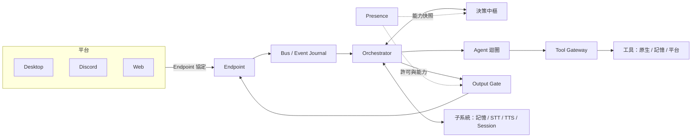

# U.E.P 架構概觀

本文只寫重點，給第一次接觸這個 repo 的人建立整體圖像。詳細設計、契約與決策紀錄不公開。

## 1. U.E.P 是什麼

U.E.P（Unified Experience Partner）是長壽命的個人 AI 助理核心。它不是一次性的聊天機器人：同一個「她」跨平台（桌面、Discord、網頁）、跨時間保有身分、記憶與狀態，能聽、說、記得、主動開口，也能呼叫工具完成工作。

目前 repo 由兩部分組成：新 Core（`uep/`）與遷入的子系統（`subsystems/`），以 PostgreSQL 保存權威狀態。舊的九模組系統已移除，最後狀態保留在 git tag `legacy-final-v0.9.4`。

## 2. 總體架構

四個角色各司其職：

- **Presence**：「她現在在哪裡、能做什麼」的權威。管理平台上的存在（Lease）、可用能力與輸出許可。
- **Bus**：事件匯流與日誌。所有跨元件的事實以事件進出，信任欄位由閘道寫入。
- **Orchestrator**：回合與任務的編排者。接收輸入、取得決策、驅動回覆或 Agent 迴圈、推進狀態機。
- **Endpoint**：平台端點。各平台（桌面、Discord、網頁）透過端點協定接入，宣告自己的能力與可執行的工具。

硬性的閘門（Output Gate、狀態轉移裁決、全域停止、工具授權、Presence Lease）維持各自的權威，其他元件只能在它們允許的範圍內行動。

## 3. `uep/` 主要模組

| 模組 | 職責 |
| --- | --- |
| `presence/` | Presence 與 Lease、輸出許可（Output Gate） |
| `state/` | 狀態協調器，裁決各軸轉移 |
| `events/`、`control/` | 事件匯流與日誌、控制通道 |
| `turn/` | 回合編排：聚合輸入、提案、回覆或交給 Agent |
| `decision/` | 決策中樞：把「要不要回、走哪條路、可用哪些能力」收斂成計畫 |
| `agent/` | Agent 迴圈：單步執行、預算、心跳、可恢復的 Run |
| `tools/` | 工具註冊表、投影、Tool Gateway、原生工具實作 |
| `tasks/` | 任務與行動（ActionIntent）管線、核准與回執 |
| `stream/` | 語音串流管線：VAD、斷句、打斷、輸出 |
| `endpoint/` | 平台端點協定與連線 |
| `memory/` | Core 側的記憶存取與背景活動 |
| `echo/` | 宿主組裝：把管線、記憶、推論與工具接成可運行的 Host |
| `models/`、`persona/` | 模型閘道與人設 |
| `stop/`、`db/` | 全域停止、PostgreSQL 與 migration |

## 4. `subsystems/`

遷入的子系統保留原頂層套件名，只允許 `uep/stream/adapters/` 與 `uep/echo/*_wiring.py` 引用：

- `echo_memory`：長期記憶（含檢索與做夢整理）
- `echo_stt`：語音辨識
- `echo_tts`：語音合成
- `echo_thought_core`：Session 與思考核心

## 5. 決策中樞與 Agent 迴圈

決策中樞是整個系統的「決定在哪裡發生」：輸入進來時，它回答「回不回、怎麼回、走哪條路」，輸出的是**計畫**而不是標籤，並預先決定這一回合可以動用的能力範圍。

Agent 迴圈是「做事」的地方：中樞決定要不要啟動迴圈、以什麼範圍啟動；迴圈在這個範圍內自己思考、呼叫工具、必要時等待核准，結束後把結果回饋原本的對話。兩者的分工原則：

- 中樞是迴圈的上游：決定觸發與範圍。
- 能力範圍只收窄不放寬：迴圈執行中不能自行擴權，需要更大範圍就回到中樞重新決策。
- 迴圈特殊情況可委派中樞給建議，但建議不得超出已凍結的範圍。
- 硬閘不被收編，決策只能在閘門允許的結果內選擇。

## 6. 工具契約要點

- **ToolEntry**：註冊表的唯一單位，同一筆資料承載分類（副作用、冪等、是否綁 Presence）、輸入輸出 schema、說明與能力標籤。所有來源的工具都以同一種 ToolEntry 進表。
- **能力標籤**：一個工具對應一個標籤，決策層用標籤集合表達「這一回合能做什麼」。標籤屬於程式碼定義的閉集，新增需要改碼與審核。
- **原生工具**：Core 自己的能力，例如 Lore Vault 記憶庫、Chatroom、網路搜尋與擷取、圖片讀取；憑證只存在執行端，不進模型可見的內容。一般對話只開放唯讀類，寫入類只在 Agent 迴圈內提供。
- **核准**：有副作用的行動走完整四階段（建立、核准、執行、回執）；需要核准時迴圈暫停，核准後從原處續跑，而不是卡死迴圈。原生寫入工具另由各自服務端複審。
- **平台投影**：送給模型的工具清單，恰為「註冊表依能力標籤、平台、Presence 與模組就緒狀態投影」的結果，沒有其他來源。平台只能宣告候選工具，是否採用由 Core 核准。

## 7. 週期路線

- **週期二：核心**。Core 骨架、Presence／Bus／Orchestrator、子系統遷入、語音管線、決策中樞與 Agent 迴圈、工具契約與原生工具。
- **週期三：平台**。桌面、Discord、網頁以端點協定接入同一個 Core，平台宣告與遠端工具執行，缺席端輸入。
- **之後：自主**。主動決策、全域做夢迴圈、以標註資料訓練決策模型，逐步讓她自己決定何時開口與做事。

## 8. 延伸

- `docs/index/`：INDEX 與 TRACKING，查「東西在哪」與「做到哪」。
- 詳細設計、契約與決策紀錄不公開。
